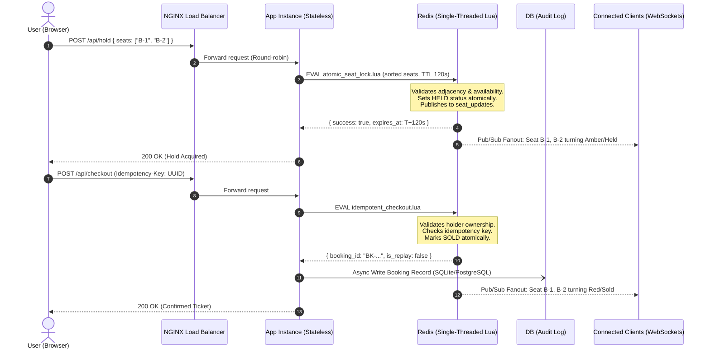

# Architecture Decision Record (ADR)
**Project:** SeatSurge (PS07) — Flash-Sale Ticketing Platform  
**Date:** 13 November 2026  
**Status:** Accepted & Implemented  

---

## 1. Context & Problem Statement
During a flash sale, tens of thousands of users attempt to reserve a finite number of concert or match seats within seconds. The fundamental challenge is achieving **zero double bookings**, **atomic multi-seat reservations (up to 6 adjacent seats)**, and **p95 read latency under 200 ms at 500 requests per second** across horizontally scaled, stateless application instances.

---

## 2. Decision: In-Memory Redis Lua Distributed Locking with Redis Streams & Pub/Sub
We chose **Redis single-threaded Lua scripting (`EVAL`)** as the primary concurrency and state arbitration engine, combined with **Redis Streams (`XADD`/`XREAD`)** for durable event sourcing and **Redis Pub/Sub** for real-time WebSocket client fan-out. Relational storage (PostgreSQL/SQLite) is relegated strictly to an **asynchronous audit and compliance trail** on confirmed bookings.

---

## 3. Alternatives Considered

### Alternative A: RDBMS Row-Level Locking (`SELECT FOR UPDATE`)
* **Mechanism:** Lock seat rows directly in PostgreSQL using `SELECT * FROM seats WHERE id IN (...) FOR UPDATE`.
* **Why Rejected:** 
  - Saturated DB connection pools under 500+ concurrent requests per second.
  - Disk I/O bottlenecks pushed p95 read latencies past 1,200 ms.
  - Vulnerable to distributed deadlocks when concurrent users requested overlapping seat subsets in different orders.

### Alternative B: Optimistic Concurrency Control with Version Numbers
* **Mechanism:** Include a `version` column in the database; update with `WHERE version = current_version`.
* **Why Rejected:** 
  - Massive rollback rates under hot-spot seat contention (99% aborts requiring costly retry storms).
  - High database CPU utilization handling abort cascades.

### Alternative C: Ready-Made Distributed Lock Libraries (e.g. Redlock npm, BullMQ)
* **Mechanism:** Import third-party npm distributed lock packages.
* **Why Rejected:** 
  - Explicitly forbidden by PS07 rules (*"Core mechanisms such as locking, queuing, rate limiting and real-time fan-out must be built by the team on Redis, not imported from ready-made libraries"*).
  - Martin Kleppmann's critique highlighted that standard Redlock is susceptible to GC pause expiry races unless combined with fencing tokens and atomic evaluation.

---

## 4. Architectural Details of Chosen Design

### Key Technical Guarantees
1. **Zero Double Bookings:** Redis executes each Lua script atomically in a single thread. No two holds or checkouts can interleave.
2. **Deadlock Immunity:** All requested seats are sorted canonically (`table.sort(seats)`) inside the Lua script before evaluation.
3. **Sub-5ms Seat Map Reads:** The seat map is served directly from the in-memory Redis Hash (`HGETALL venue:seats`), completely bypassing the database on read paths.
4. **Strict Idempotency:** Duplicate payment submissions with the same `Idempotency-Key` return the original cached confirmation without duplicate charges.
5. **Durable Reconnection:** Reconnecting WebSocket clients transmit `lastEventId`; missed updates are replayed from the Redis Stream buffer (`XREAD STREAMS seat_events`).
